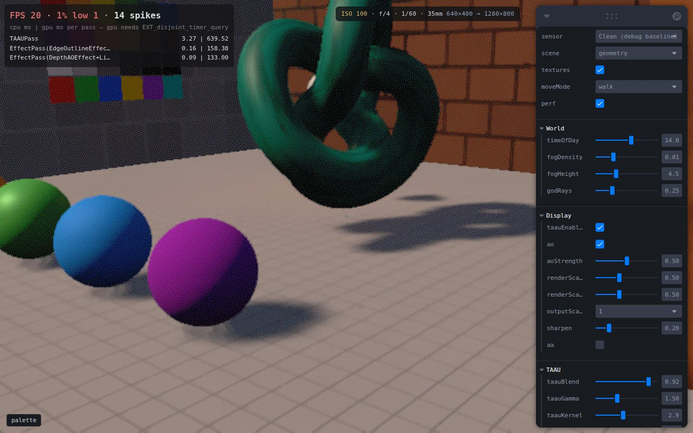

# gp-render

A browser playground for rendering experiments, live at [render.gabrielpenman.com](https://render.gabrielpenman.com). It's built on Three.js and has blue-noise and Bayer dithering, palette ramps with an editable colour lookup table, camera-style grain and depth of field, and a raymarched scene. The build also exports its scenes as a standalone module, and [gp-design](https://github.com/Volcanex/gp-design) loads that module so the scenes show up there as layers.



## Running it

You need Node 22 and Python 3.11 or newer.

```sh
cd web && npm install && npm run build
cd ../server && pip install fastapi uvicorn && uvicorn app:app --port 8094
```

For live reloading while you work on the frontend, run `npm run dev` in `web/` instead.

## Licence

Source-available under the [PolyForm Noncommercial License 1.0.0](LICENSE). You can read it, run it and change it for any noncommercial purpose.

Required Notice: Copyright Gabriel Penman (https://gabrielpenman.com)

Blue-noise textures: Christoph Peters, CC0, momentsingraphics.de/BlueNoise.html
